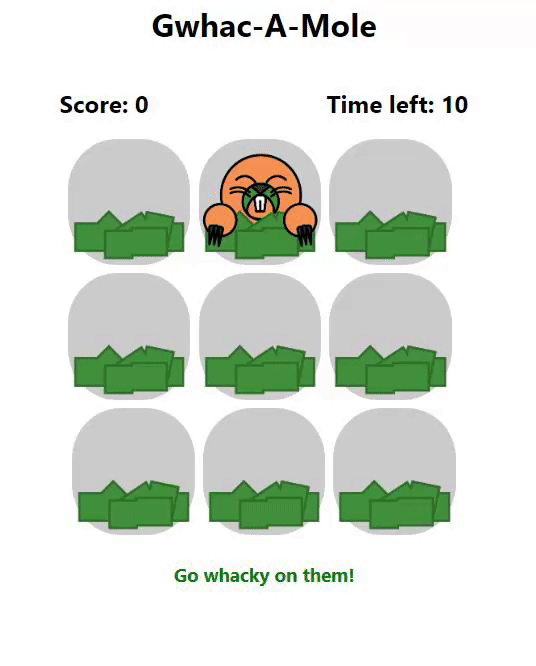

<!-- unlv-museum-banner-start -->
<a href="https://unlv-museum.recanon.com/gwhac-a-mole" target="_blank" rel="noopener">
  <picture>
    <source media="(prefers-color-scheme: dark)" srcset="https://unlv-museum.recanon.com/github-banners/gwhac-a-mole?theme=dark&v=3bdc7e092d">
    
  </picture>
</a>

> This `museum-ready/original` branch is the host-compatible build of the [`original` branch](https://github.com/moefingers/gwhac-a-mole/tree/original) — [audit the diff](https://github.com/moefingers/gwhac-a-mole/compare/original...museum-ready%2Foriginal): hosting fixes only (dead URLs, Node LTS floor, pnpm), behavior byte-for-byte. [Open in museum →](https://unlv-museum.recanon.com/gwhac-a-mole)
<!-- unlv-museum-banner-end -->

# Gwhac - a - Mole

A little play on whack-a-mole. In this case, I've made the hills into piles of Guacamole.
I went above and beyond for this project, far exceeding any instructions, and I'm super proud of it.

This one goes out to React devs.

Now deployed on GitHub. \
[Play now!](https://moefingers.github.io/gwhac-a-mole/)